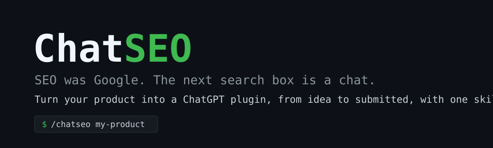

<p align="center"></p>

<p align="center">
  <b>Get your product inside ChatGPT, where people already ask for it.</b><br>
  A <a href="https://docs.claude.com/en/docs/claude-code/skills">Claude Code skill</a> that builds, tests and ships a ChatGPT plugin for any product, website or API.
</p>

<p align="center">
  
  
  
  
</p>

---

ChatGPT now runs third-party **plugins** (built on the Apps SDK / MCP) right inside the conversation.
Someone asks *"convert this PDF to Excel"*, *"what's the best move here?"* or *"how do I prep for this team?"*,
and the plugin that actually answers it gets the user.

**Every big platform has a short window where getting users is cheap:** Facebook apps in 2007, the App Store in 2008, TikTok in 2019. ChatGPT plugins are that window right now.

ChatSEO is the playbook as one skill. Point Claude Code at your product and it runs the whole thing:

```
/chatseo my-product
```

## What it does

| Step | What happens |
|---|---|
| **1. Go / no-go** | One-line value test. Kills ideas OpenAI will reject (ad-only plugins, demos, link-only "apps") *before* you write code. |
| **2. Tool design** | 2-4 tools built on **your real data or engine**, with metadata written the way ChatGPT matches tools to prompts ("Use this when..."). |
| **3. MCP server** | Drop-in Node 22 template: stateless Streamable HTTP `/mcp`, zod validation, rate limit, optional inline widget, domain-check route. |
| **4. Hosting** | Cheapest path on your own domain: Firebase Functions, Cloud Run or Vercel. |
| **5. Live check** | `check_mcp.py` runs initialize, tools/list and tools/call against the real URL, and fails on bad metadata or empty answers. |
| **6. Submission pack** | Privacy section, listing copy, 5 positive and 3 negative test prompts, release notes, plugin zip, portal steps. |
| **7. Submit** | Walks the OpenAI Plugins portal with you. You keep the clicks that are yours: identity check and accepting the terms. |

## Install

```bash
git clone https://github.com/Oreldm/chatseo
cp -r chatseo/skills/chatseo ~/.claude/skills/        # macOS / Linux
# Windows: xcopy /E /I chatseo\skills\chatseo %USERPROFILE%\.claude\skills\chatseo
```

Then in Claude Code: *"Make a ChatGPT plugin for my product"*, or `/chatseo`.

Test any MCP endpoint without the skill:

```bash
python skills/chatseo/tools/check_mcp.py https://your.site/mcp \
  --call search_items '{"query":"pricing"}' \
  --expect-error search_items '{"query":""}'
```

## The honest part (read before you build)

- **ChatGPT will not start recommending you on day one.** New plugins are found by name search or a direct link. Suggestions in conversation and directory placement are picked by OpenAI, and you can't apply for them. Real usefulness and sharp metadata are the levers, and that's what this skill optimizes.
- **Ad-only plugins get rejected.** "Download our app" is not a plugin. The skill's go / no-go step exists for exactly this.
- **No selling digital goods inside the plugin.** Commerce is physical goods only, with no checkout links. Use the plugin to bring users to you, not to make the sale.
- **Your developer account must be verified** (platform.openai.com > Settings > Organization). That's an identity check only you can do.

The skill reads OpenAI's live docs on every run, because the rules move.

## Good fits

- A **real engine:** calculators, converters, solvers, analyzers, game move engines
- **Your own data:** catalogs, knowledge bases, findings, listings, docs
- The **user's account** (OAuth): their orders, files, stats
- **Interactive widgets:** a board, a map, a chart, a playable mini-game

## Repo layout

```
skills/chatseo/
  SKILL.md              the playbook Claude follows
  templates/server.mjs  MCP server template (Node 22, @modelcontextprotocol/sdk)
  tools/check_mcp.py    live endpoint checker (Python stdlib only)
```

## Contributing

Found a new review rule, a rejection reason, or a hosting recipe? Open a PR. Rejection notes are gold.

---

<sub>Not affiliated with, endorsed by, or sponsored by OpenAI or Anthropic. "ChatGPT" is a trademark of OpenAI. MIT licensed.</sub>

If ChatSEO got your plugin approved, star the repo so the next builder finds it.
